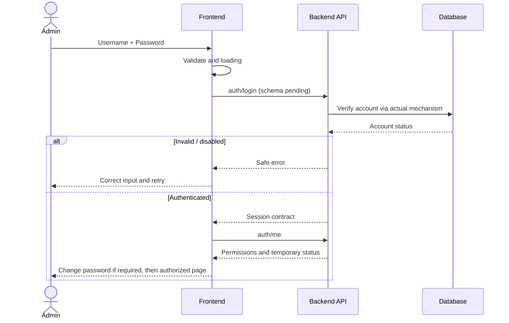
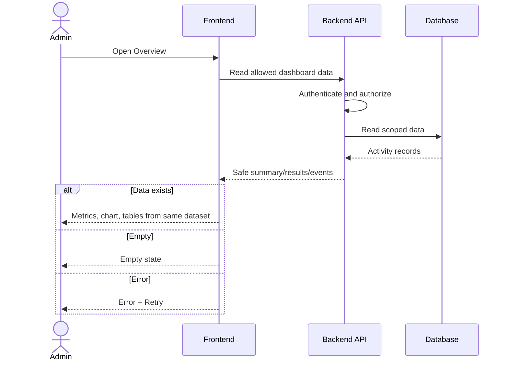
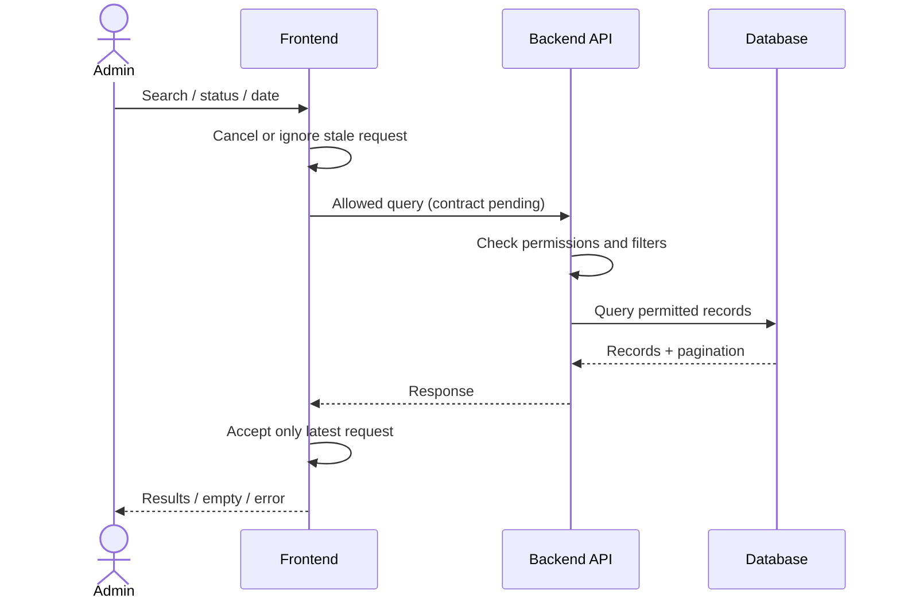
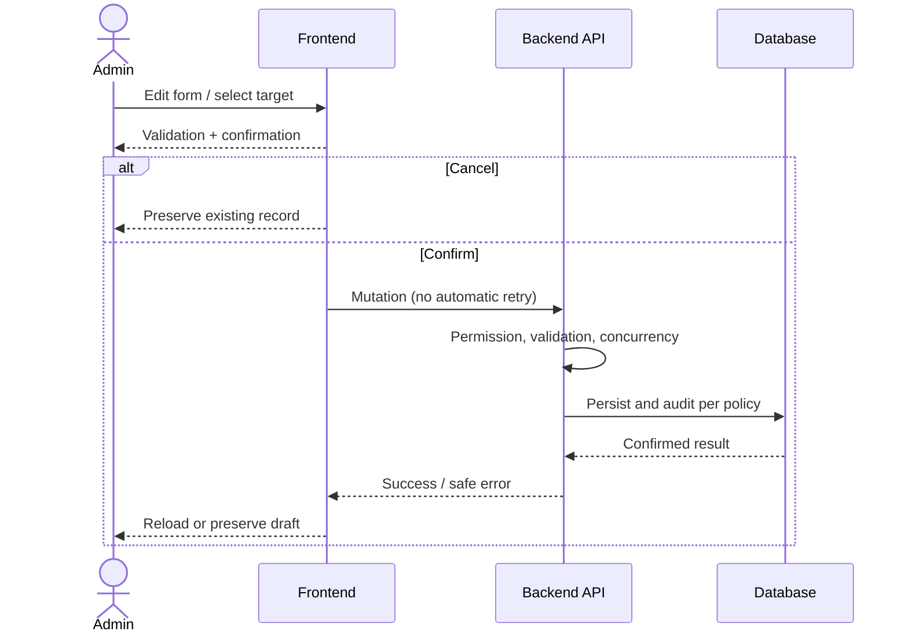
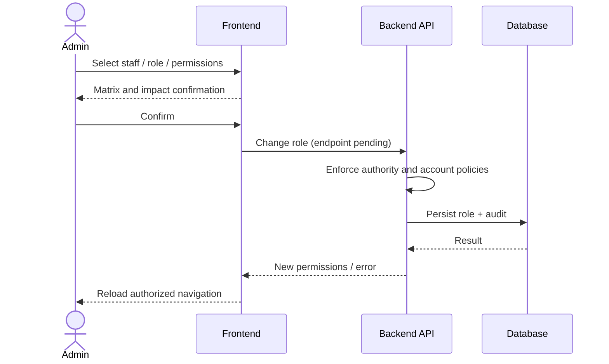

# Workflow diagrams — proposed integration

ทั้ง 6 แผนภาพใช้ Admin, Frontend, Backend API และ Database แยกกัน Backend/Database ยัง Not Verified; UI ปัจจุบันเรียก Mock adapter ในหน่วยความจำแทน เปิดภาพพร้อมสีและแบบพิมพ์ได้ที่ `workflow.html`

## Authentication



## Dashboard data



## Search and filter



## Create, update and delete



## Permissions



## Logout and session expiry

```mermaid
sequenceDiagram
    actor A as Admin
    participant F as Frontend
    participant B as Backend API
    participant D as Database
    A->>F: Logout
    F-->>A: Confirm discard if draft exists
    F->>B: End/revoke session (contract pending)
    B->>D: Revoke persisted session if applicable
    D-->>B: Result
    B-->>F: Confirmed logout
    F->>F: Cancel pending requests, clear view/state
    F-->>A: Login
    Note over F,B: Expired session: server denies access; client clears data and returns to Login
```
